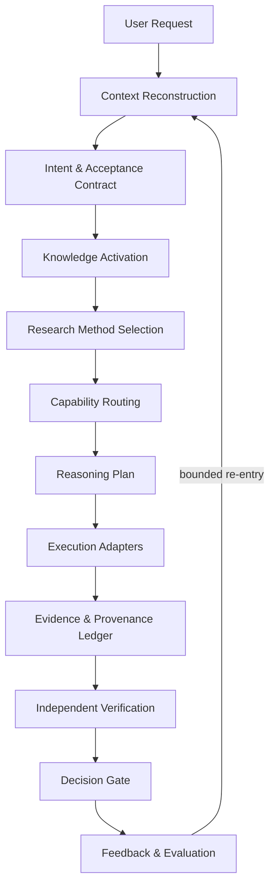

# System Architecture — RIGOR-X

## 1. Context / trust boundaries

- User and host context are inputs, not assumed facts.
- Retrieved files/webpages/connectors are untrusted content.
- Planning outputs cannot impersonate tool receipts.
- Execution adapters have explicit capability contracts.
- Persistent stores are separate from the transient model context.
- Secrets are injected at runtime and excluded from source, logs and artefacts.

## 2. Planes

## 3. Component responsibilities

| Component | Contract | Current status |
|---|---|---|
| Pipeline state machine | Stage progression, gate, re-entry, status | IMPLEMENTED; prior CI verified |
| SQLite run persistence | Atomic snapshot/event, revision, restore | Implementation submitted in this increment; CI pending |
| Registry resolver | Versioned KD/TP/OP/FM/AL/FG/CMD activation | NOT IMPLEMENTED |
| Research orchestrator | Method + channel plan and actual acquisition receipts | NOT IMPLEMENTED |
| Capability router | Host tool/adapter capability matching | NOT IMPLEMENTED |
| Execution adapter framework | Authorized calls, receipts, idempotency | NOT IMPLEMENTED |
| Evidence/provenance service | Source/claim/derivative links, contradiction records | NOT IMPLEMENTED |
| Verification policy | Independent checks, acceptance, decision gates | PARTIAL: stage-level gate only |
| Feedback engine | Outcome capture, evaluation, promotion gates | PARTIAL: stage transition only |
| Security/authorization | Identity, permissions, trust boundary policy | NOT IMPLEMENTED beyond state controls |

## 4. Data contracts

Run envelope includes run_id, pipeline_version, current_stage, status, verification_accepted, reentry_count, max_reentries, stage_status, events.

Durable record wraps envelope with monotonically increasing revision. Event history is append-only. Revision compare-and-swap prevents concurrent overwrites.

## 5. Error policy

Use typed errors; do not collapse transient, permanent, auth, validation, conflict, or integrity errors. Retries are adapter-level, bounded, jittered, and only for idempotent or deduplicated operations. Storage operations use transaction boundaries and integrity checking.

## 6. Scalability / evolution

SQLite is the initial local single-node persistence adapter. The interface is designed to permit later PostgreSQL/cloud backend adapters; no backend parity or multi-node capability is implied. Registry and evidence layers should be independently versioned.
