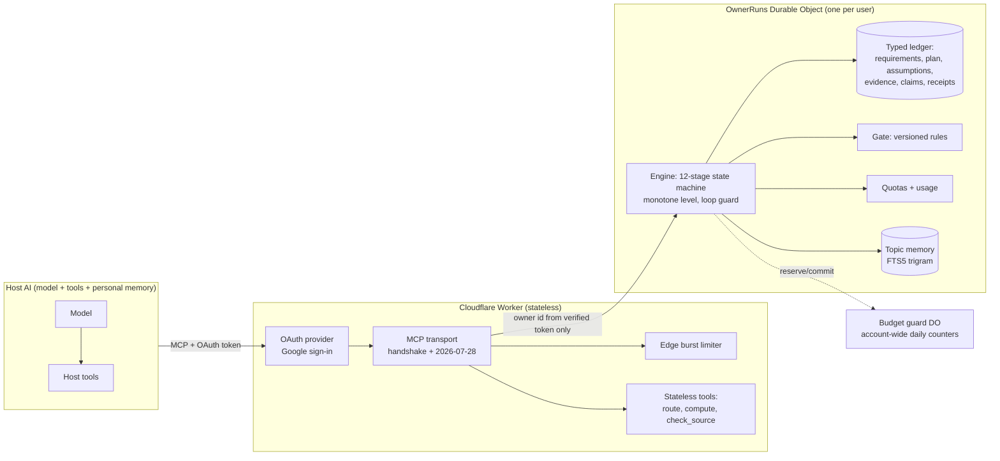

# WS32 — Cognitive OS Reassessment: State Recovery, Audit, Target Architecture, Roadmap (2026-11-26)

**Status:** DRAFT for owner review · **Responds to:** the owner's "RIGOR.X — Cognitive Operating System Evolution" master directive (2026-11-26) · **Builds on:** [25-MAJOR-UPGRADE-SPEC-AND-ADRS.md](25-MAJOR-UPGRADE-SPEC-AND-ADRS.md) and [26-SESSION-HANDOFF-2026-11-25.md](26-SESSION-HANDOFF-2026-11-25.md) (both on branch `ccr-5630b1ba-fp2mi5`, not yet on `main`).

Evidence tags: **[A]** verified in this session, with the method named (code read, test run, local `wrangler dev`, live probe); **[B]** cited source, with where it was read; **[B-]** taken from the 2026-11-25 handoff and not re-verified today; **[C]** design judgment or unverified. Verification levels follow directive §06: STATICALLY_INSPECTED, TYPE_CHECKED, LINTED, UNIT_TESTED, INTEGRATION_TESTED, EXECUTED, LIVE_TESTED, INDEPENDENTLY_VERIFIED.

---

## 0. Executive summary

1. **State is as handed off.** `main` = `73c2169`; no work landed since the handoff. The live Worker enforces OAuth (no token → `401` + `resource_metadata`; bad token → `401 invalid_token`); a signed-in Claude connector call works. Tests at `73c2169`: Python 204 OK, TypeScript 17/17, parity OK, ruff clean. [A]
2. **Five new findings change priorities** (§2.2):
   - **N1 — Critical: one account can take the service down for everyone.** Any Google account can sign in, there are no quotas, and the Workers Free ceilings are shared by the whole account: 100,000 Worker requests/day, 100,000 Durable Object rows written/day, 5 GB storage; when a daily limit is exceeded, operations of that type fail until 00:00 UTC. [B: Cloudflare docs] ⇒ quotas (P0.3) move ahead of MCP 2026-07-28 (P0.2).
   - **N2 — Critical once level-dependent stages land: "unknown" is routed as "trivial".** The router maps "no keyword signal" to `INFORMATION`/`L01_BASIC`. Every non-English task has no signal: a Bengali task about a leaked bank password and permanently deleting production data was routed `L01_BASIC`, `risk_score 0` on the live server. [A: live `rigorx_route`] Under ADR-003, L01 means four mandatory stages, so non-English users would get the least rigor exactly when stakes are highest. This is directive §2.2 "Unknown → Zero".
   - **N3 — High, live bug: Chinese, Japanese and Thai stage summaries are rejected.** TextPolicy counts words by whitespace; scripts without spaces count as one word. Substantive 42–77-character summaries in zh/ja/th fail the 6-word rule in both engines. [A: TS and Python engines] `Intl.Segmenter` works in workerd (zh 15, ja 11, th 12 words) and fixes it. [A: local `wrangler dev`]
   - **N4 — MCP 2026-07-28 is a hardening task, not an outage.** The official Python SDK `mcp 2.3.0` defaults to `mode="auto"`: it probes `server/discover` and falls back to `initialize` on any JSON-RPC error. Its client ran a full run to COMPLETED against our MCP handler. [A: SDK source read + smoke run]
   - **N5 — The TypeScript code had no reproducible type check.** `npm run typecheck` calls `tsc`, which is not installed; tests only strip types. With an out-of-repo toolchain, `src/` passes `tsc --strict --noUncheckedIndexedAccess` against `@cloudflare/workers-types`. [A]
3. **First work package done on branch `ccr-5b851448-kfkjy3` (not deployed):** P0.1 spike-token removal (`75698e0`) and removal of the dead Python Worker that shared the live Worker's name (`4a356c2`). Differential evidence on the real Worker code under `wrangler dev`, with the token still configured: before → static token **HTTP 200**; after → **HTTP 401 `invalid_token`**; OAuth discovery, registration and consent unchanged. [A]
4. **Owner decisions needed:** merge to `main` (deploys), then delete two leftover secrets; approve the P0 reorder; quota numbers; when to move to Workers Paid (§9).

---

## 1. Phase A — project state recovery

| Item | Finding | Tag |
|---|---|---|
| Branches | `main` = `73c2169` ("Bump the verification gate to 1.1.0"). Handoff branch `ccr-5630b1ba-fp2mi5` = `73c2169` + `bc75eb4` (spec) + `2d2b7d7` (handoff), docs only. Work branch `ccr-5b851448-kfkjy3` started at `73c2169`. Historical references `73c2169`, `bc75eb4`, `2d2b7d7` all exist. | A |
| Tests at `73c2169` | Python **204** OK (2.3 s); TypeScript **17/17**; `parity.json matches the Python engine`; ruff 0.16.9 clean. Running Python tests rewrites tracked `.pyc` files (restored with `git checkout`). | A |
| Type check | Not reproducible in the repo (no `typescript` dependency). Out-of-repo `tsc 5.9.3` + `@cloudflare/workers-types`: `src/` clean; `test/parity.test.ts` has 2 type errors from a Node/Workers `URL` type clash (types only, tests pass). | A |
| Live Worker | `GET /` banner, `/privacy`, `/terms` 200; protected-resource and authorization-server metadata 200; `POST /mcp` without token 401 with `resource_metadata`; bogus bearer 401 `invalid_token`. Via the Claude connector: `rigorx_profile` → `ca82b715…`, `rigorx_route` works. | A (live probe) |
| Environment | Cloud environment "rigor.x" allows `rigorx-mcp.aetherica.workers.dev` and package registries; `developers.cloudflare.com` and `modelcontextprotocol.io` are blocked (fetch failed with DNS errors), so Cloudflare docs were read through the Cloudflare documentation-search tool and MCP behaviour through the official SDK packages from PyPI/npm. | A |
| Memory notes | `owner-working-style`, `vector-memory-decisions`, `cloudflare-deploy` read; consistent with the handoff. | A |

---

## 2. Phase B — independent audit

### 2.1 The sixteen 2026-11-25 findings, re-classified against today's code

| # | Finding | Status | Evidence |
|---|---|---|---|
| 1 | Criteria authored at verification time (goalpost moving) | UNRESOLVED | `engine.ts` `verify()` takes criteria only at VERIFICATION; nothing is pre-registered. [A] |
| 2 | Gate strictness depends on keyword-routed intent | UNRESOLVED, **worse than recorded** | `research_has_sources` / `execution_has_actions` exist only if `meta.intent` is RESEARCH / EXECUTION; non-English tasks route to INFORMATION (N2), i.e. the weakest gate. [A] |
| 3 | Every pre-verification stage skippable | UNRESOLVED | `NO_SKIP = {VERIFICATION, DECISION, FEEDBACK}`: 8 of 11 stages skippable with a 15-char reason. [A] |
| 4 | Spike token = permanent backdoor | **RESOLVED on branch, not deployed** | `75698e0`; before/after probe in §8. Live server accepts the token until the branch is deployed and the secret deleted. [A] |
| 5 | No quotas or rate limits | UNRESOLVED, **raised to Critical** (N1) | No counters anywhere in `src/`; only per-run caps (500 evidence, 50 criteria, 6 re-entries). [A] |
| 6 | No retention, no run listing | UNRESOLVED | `RUN_OPERATIONS` has no list; nothing expires. [A] |
| 7 | Whole-run snapshot rewritten per call (O(n²)) | UNRESOLVED, **bounded → Medium** | Measured: 1.2 ms/call at 100 evidence, 5.6 ms at 499; snapshot 150 KB at 499; one `UPDATE` per call. Cap of 500 bounds a full run at ≈1.4 s CPU on this host; Durable Object CPU limit is 30 s per request [B]. Cost, not correctness. [A: benchmark] |
| 8 | Every response returns the full `actions` list | UNRESOLVED | Measured `get_run` = **28,058 bytes** with 499 actions (≈7k tokens on every call). [A] |
| 9 | `listChanged: false`; hosts cache tool descriptions | UNRESOLVED | `mcp.ts` `initialize`. [A] |
| 10 | Real Worker auth path not tested in CI | UNRESOLVED, **now cheap to fix** | CI runs `scripts/dev-server.ts` (own token check) and `npm test` without `npm ci`, so `auth.ts` and the OAuth provider are never loaded in CI. This session ran the real Worker under `wrangler dev` in this container with a probe script (§8). [A] |
| 11 | Unsalted profile ID | UNRESOLVED | `opaqueId = sha256(owner)[:32]`; recomputed offline: `sha256("spike:dev")[:32]` = `51eb92e2e87577db6c170c6fc59bb8a5`, exactly what `wrangler dev` returned. Anyone who knows a Google `sub` can compute and correlate the ID. [A] |
| 12 | Text policy bypassable; skip reasons not de-duplicated | UNRESOLVED **+ new defect N3** | "Distinct" = exact digest of normalized text, so a one-word change passes. [A] |
| 13 | `source_ref` never validated | UNRESOLVED | Free text up to 2,048 chars. [A] |
| 14 | Abandoned threads on tool timeout | UNRESOLVED, Low | `agent_runtime.py:293–304`; local runtime only, not on the plugin path. [A] |
| 15 | Stale README and docs | PARTIALLY_RESOLVED | Root and Worker READMEs corrected in `75698e0`/`4a356c2`; engineering docs 00–24 not reviewed. [A] |
| 16 | Tracked `.pyc`, no root `.gitignore`, dead Python Worker in CI | PARTIALLY_RESOLVED | Python Worker removed (`4a356c2`); **44** tracked `.pyc` remain; no root `.gitignore`. [A] |
| S1 | Two engines, two orchestration paths | UNRESOLVED (by design until the conformance suite stands, ADR-001) | [A] |
| S2 | `reasoning_controller`, `command_runtime`, `registry` unused at runtime | CONFIRMED | No runtime module imports them; `reasoning_guard` is imported only by `reasoning_controller`. ADR-004 should reuse `reasoning_guard`'s fingerprint; the rest are OBSOLETE candidates. [A: import graph] |
| S3 | Worker lacks the slash-command catalogue | UNRESOLVED | `resolveCommands` throws. [A] |

### 2.2 New findings

| ID | Severity | Finding | Evidence |
|---|---|---|---|
| N1 | **Critical** | Availability: open sign-up + no quotas + account-wide Free ceilings ⇒ one actor (≈1.2 requests/s for a day) exhausts 100,000 rows written/day, after which every user's writes fail until 00:00 UTC. The 100,000 requests/day Worker limit is consumed even by unauthenticated `401`s, which code cannot prevent; only a WAF rate-limiting rule or Workers Paid helps there. | [B: Cloudflare DO pricing page (updated 2026-11-13): Free 100,000 rows written/day, 5M rows read/day, 5 GB total, "further operations of that type will fail", reset 00:00 UTC; Workers Free 100,000 requests/day stated on the Workflows pricing page ("shared with Workers requests")] |
| N2 | **Critical** (precondition for ADR-003) | Router: no signal ⇒ INFORMATION/L01 (Unknown → Zero). English-only keyword lists; also misses security vocabulary: "remove the spike-token authentication bypass" → `risk_score 0`, L03. | [A: live `rigorx_route`, two probes, 2/2 false negatives] |
| N3 | **High** (live) | TextPolicy rejects zh/ja/th summaries (whitespace word count). Bengali passes. | [A: both engines] |
| N4 | Medium | MCP 2026-07-28: current server interoperates with auto-mode clients through fallback; native support (stateless envelope, `Mcp-Method`/`Mcp-Name`, `-32020`, `-32022`) is still missing. A modern-only client would fail. | [A: `mcp 2.3.0` `client/_probe.py`, `mcp_types/version.py`, smoke run] |
| N5 | Medium | No reproducible TypeScript type check in repo or CI. | [A] |
| N6 | Low | JS `\b` is ASCII-only, Python's is Unicode-aware; parity fixtures are ASCII-only, so router divergence on mixed-script text is untested. Moot if the router is demoted (§5). | [A: code read] |
| N7 | Low | After P0.1, runs owned by `spike:dev` stay in the Durable Object named `sha256("spike:dev")`, unreachable through the API (a few test runs per the handoff). | [A: code read; count UNKNOWN] |
| N8 | Info | 5 GB ÷ 120 MB = **42.7** users at full memory quota on Workers Free; every user shares the 100k rows/day budget. | [arithmetic on B] |

---

## 3. Phase C — research → engineering map

Research was targeted at decisions this roadmap must make now (directive §38: no endless expansion). Broad domains are classified, not re-researched.

| Topic | Source and status | Finding | Engineering implication | Cat. |
|---|---|---|---|---|
| MCP 2026-07-28 | [B] MCP blog, "The 2026-07-28 MCP Specification Release Candidate" (blog.modelcontextprotocol.io); [A] reference implementation `mcp 2.3.0` / `mcp-types 2.3.0` (PyPI) source. Spec pages on modelcontextprotocol.io could not be fetched (blocked). | `initialize` and `Mcp-Session-Id` removed; version, client info and capabilities travel in `_meta`; `Mcp-Method`/`Mcp-Name` headers, mismatch → `-32020`; unsupported version → `-32022` with `data.supported`; `server/discover` returns `supportedVersions`, `capabilities`. Auto-mode clients fall back to `initialize` on every JSON-RPC error except a disjoint `-32022`, and also when `supportedVersions` lists no modern version. 12-month minimum between deprecation and removal for features. | P0.2: implement the modern envelope alongside handshake versions; conformance-test with `mcp 2.3.0` in both `mode="auto"` and modern-only. Not urgent (N4). | A |
| Cloudflare limits | [B] Cloudflare docs via the documentation-search tool: DO pricing/limits (updated Nov 2026), Rate Limit binding (updated 2026-11-12). | See N1. DO CPU 30 s/request default. Rate Limit binding: `simple.limit`, `period` 10 or 60 s, **approximate, per Cloudflare location**, "requests can exceed this threshold". Free-plan availability of the binding not stated in what was read. | P0.3: authoritative per-owner counters in the owner's Durable Object (single-threaded ⇒ exact); account-wide daily budget in one guard object; the Rate Limit binding only as a cheap burst filter at the edge. | A |
| Multilingual text measure | [A] `Intl.Segmenter` in local workerd (compat date 2026-09-07). | Word-like segments: zh 15, ja 11, th 12, bn 7, en 9 for one sentence each. | N3 fix in TS; Python reference needs a script-aware fallback or the check moves to the TS-only conformance suite. Production workerd not live-verified. | A |
| Agentic security | [B] OWASP Top 10 for Agentic Applications (OWASP GenAI blog 2025-12-09; TechRepublic summary). Primary list text not fetched. | ASI01 goal hijack, ASI02 tool misuse, ASI03 identity/privilege abuse, ASI04 supply chain, ASI05 unexpected code execution, ASI06 memory and context poisoning, ASI07 inter-agent communication; ASI08–10 not verified today. | Threat model (P5); ASI06 controls in topic memory (P2): data envelope, provenance, trust weights, write limits. | B |
| Cognitive architectures | [B, established literature, not re-fetched]: Soar (Laird, *The Soar Cognitive Architecture*, 2012), ACT-R (Anderson et al., *Psychological Review* 2004), blackboard systems (Nii, *AI Magazine* 1986), Global Workspace Theory (Baars 1988), LIDA (Franklin et al.). | Transferable mechanisms are architectural, not biological: a shared typed workspace (blackboard), condition–action rules over it, impasse → subgoal, bounded working memory. | RIGOR.X already is a blackboard + rule gate: the run ledger is the workspace, the gate is the rule set, `VERIFICATION_FAILED → reenter` is impasse handling. Make it explicit: typed ledger entries (requirements, assumptions, claims, plan nodes) and versioned gate rules over them. Bounded working memory ⇒ response budgets (finding 8). | A (ledger/rules) |
| Consciousness theories (GWT as consciousness, IIT) | [C] | No operational mechanism a control plane can test; IIT is contested. | Do not implement; never claim (AC-20). | D |
| Humor | [B, established]: Raskin, *Semantic Mechanisms of Humor* (1985, script opposition); Attardo & Raskin, General Theory of Verbal Humor (*Humor* 1991); McGraw & Warren, benign violation (*Psychological Science* 2010). | Humor needs an incongruity that is resolved and benign for this audience; risk is contextual. | RIGOR.X makes no model calls (owner decision), so it cannot generate humor. What it can do deterministically: a **humor policy gate** returned with DELIVER guidance — allowed / style / intensity cap / suppress — from host-declared context, **default suppress when context is unknown**, hard suppress for emergency, grief, medical, legal, security-incident and negotiation contexts; host generates; feedback recorded. Testable with the ten contexts of directive §13. | B |
| Calibration | [B, established]: Brier score (Brier 1950); reliability diagrams. | Calibration needs stated probabilities and later outcomes. | P4: record host-stated confidence per requirement and outcome feedback; report Brier score per host. Not before outcomes are captured. | B |
| Bayesian update, expected utility | [B, textbook] | Deterministic once inputs exist; defensibility of inputs is the host's burden. | `rigorx_compute` function library (P1): Bayes, EU, unit-checked arithmetic, with input provenance in the receipt. | B |
| Units | [B] BIPM, *The International System of Units (SI Brochure)*, 9th ed., 2019. | Dimensional analysis is mechanical. | `rigorx_compute` with dimensions; catches the EUV CGS/SI error (Test B). | A |
| Memory evaluation | [B-] LongMemEval (five abilities) | — | P2 evaluation design. | B |
| LLM-as-judge | [B-] needs calibration against human labels | — | Do not use as a gate. | C |

---

## 4. Phase D — mathematical and heuristic audit

Every numeric mechanism currently in the plugin path:

| Mechanism | Formulation | Assessment |
|---|---|---|
| Router risk score | `r = min(5, |H|)`, `H` = matched English keyword patterns; `r ≥ 1 ⇒ L05`. | Dimensionless count, **not a probability**, uncalibrated, English-only. Measured false negatives 2/2. Unknown (no signal) is mapped to the lowest level. Must not be a rigor floor (§5, L03). |
| Level rule | Ordered `if` chain on hyper keywords, `r`, intent, a 120-word length signal. | Heuristic; length is not complexity (directive §10). Keep only as a seed. |
| TextPolicy | Completed summary: `chars ≥ 40 ∧ words ≥ 6`; notes: `≥ 15 ∧ ≥ 3`; `words` = whitespace tokens containing a letter or digit; `chars` = code points. | Heuristic thresholds, never calibrated. **Wrong for scripts without spaces** (N3). Code points over-count combining marks (lenient direction, acceptable). Fix: `Intl.Segmenter` `isWordLike`; measure false-reject rate on a multilingual corpus before choosing thresholds. |
| Distinct summaries | Reject iff `sha256(normalize(s))` equals another stage's. | Exact equality only; trivially bypassed. A similarity rule (token-set Jaccard exists in `reasoning_controller`) would need a calibrated threshold; the real fix is stage-specific structured contracts (ADR-002), not prose similarity. |
| Own-evidence check | Passed criteria `C_i` with cited sets `E_i`: pass iff `∀i: E_i \ ⋃_{j≠i} E_j ≠ ∅`. | Correct as specified; `O(k²·m)`, `k ≤ 50`. Structural only: one dummy record per criterion satisfies it. |
| Digests | SHA-256 of raw UTF-8. | NFC/NFD variants of the same text hash differently, so a host re-hashing its criteria can mismatch. Low; normalise to NFC before hashing under a new protocol version. |
| Run ID | 24 random bytes (`crypto.getRandomValues`), base64url. | 192 bits; unguessable; plus owner scoping. Sound. |
| Loop guard (`reasoning_guard`, not wired) | NFKC + casefold + punctuation-stripped SHA-256 fingerprint; stall iff `max − min ≤ δ` over window `w`; hard step budget; terminal states latched. | Correct for its stated purpose; reuse for ADR-004's no-progress stop. |
| Storage cost | Per call: parse previous snapshot, compare all `n` prior events, write full snapshot. | Measured linear per call ⇒ quadratic per run; bounded by 500 ⇒ cost-only (§2.1 #7). Fixed by append-only `run_events` rows (P0.4). |
| Memory quota | 120 MB/user against 5 GB/account (Free). | 42.7 full users (N8). |
| Rows-written cost per tool call | One `UPDATE host_runs` per mutating call. | **UNVERIFIED** how Cloudflare counts index rows for that update; measure in P0.3 with the SQL cursor's `rowsWritten` before choosing quota numbers. |

---

## 5. Phase E — target architecture

**Premise [C, consistent with the handoff]:** RIGOR.X is the control plane of an AI system whose cognition and tools run in the host (ChatGPT, Claude, Claude Code). It cannot see host tools or host memory, and it makes no model calls. Every "cognitive layer" of directive §08 must therefore become one of: a stage contract the host must satisfy, a typed ledger the engine keeps, a deterministic check over that ledger, or a deterministic tool. None needs its own service.

| Directive §08 layer | Concrete mechanism | Where |
|---|---|---|
| 01 Objective & intent | CLASSIFY contract: objective, deliverable, constraints, ambiguities, **pre-registered requirements** (ADR-005) | Engine + ledger |
| 02 Context & state | Append-only run events; run listing; topic memory offered at QUERY | DO |
| 03 Cognitive classification | `level = max(host-declared, router seed, floor)`, monotone; router advisory only; **no signal ⇒ `classification_unknown`, CLASSIFY not skippable** | Engine |
| 04 Capability assessment | IDENTIFY_CAPABILITIES declaration; missing capabilities must reappear in DELIVER (ADR-006) | Ledger + gate |
| 05 Method registry | Static catalogue (existing methods + knowledge domains), selection recorded with reason | Engine data |
| 06 Decomposition | Plan graph `{id, capability, depends_on, parallel_group, completion_condition}`; engine checks acyclicity and references | Engine |
| 07 Planning & resources | Plan graph + budgets (re-entries, evidence cap, quotas) | Engine + quotas |
| 08 Execution | Host executes; engine records receipts labelled `HOST_REPORTED` vs `ENGINE_VERIFIED` (compute, check_source) | Ledger |
| 09 Evidence & knowledge | Evidence ledger, claim ledger with value statuses (P3), `rigorx_check_source` | Ledger + tool |
| 10 Meta-cognition | Operational checks: coverage, assumptions register, contradiction flags, calibration metrics | Gate + P4 |
| 11 Validation & adversarial | Versioned gate rules; STRESS_TEST contract (failure scenario per critical requirement); `rigorx_compute` | Gate + tool |
| 12 Adaptation | Benchmark suite + regression CI + changelog; gate rules change only by versioned release, never at runtime | Repo/CI |

**Verification taxonomy (machine-readable, per requirement):** `structural` → `sources_resolved` → `computations_checked` → `independently_reviewed` (human or second host, recorded as such). The gate reports the highest level reached; "verified" without a level is not emitted.

**Autonomy tiers [C].** RIGOR.X itself performs no external side effects except `rigorx_check_source` fetches (public internet only). Tiers therefore classify the host's planned operations, and the engine enforces disclosure:

| Tier | Meaning | Engine rule |
|---|---|---|
| A0 Observe | read state | none |
| A1 Analyze | compute, read public sources | receipts |
| A2 Recommend | produce a recommendation | DELIVER must list assumptions and limits |
| A3 Reversible low-risk action | e.g. draft, branch push | receipt with `reversible: true` |
| A4 Consequential approved action | e.g. merge, send, deploy | receipt must cite a user-approval reference |
| A5 Restricted | irreversible, financial, security-policy, deletion of user data | user approval reference + gate refuses `passed` without it |

Tier is set by reversibility, external effect and data sensitivity, never by task length.

**Trust boundaries:** Internet ↔ Worker (OAuth only); Worker ↔ DO (owner ID derived from the verified token, never from arguments); everything a host submits is untrusted **data**: stored, hashed or returned inside a data envelope, never as instructions (memory poisoning, ASI06).

---

## 6. Phase F — gap analysis

| Severity | Gap | Phase |
|---|---|---|
| Critical | N1 quotas, rate limits, account-wide budget guard | P0.3 |
| Critical | N2 Unknown → Zero routing (must land before or with ADR-003) | P1 |
| Critical | Findings 1–3: goalposts, intent-dependent gate, skippable stages | P1 (ADR-002/003/005) |
| High | N3 multilingual TextPolicy (live bug) | P0 (small fix) |
| High | Finding 10: real auth path in CI | P0.6 |
| High | Numeric/unit verification (EUV Test B) | P1 (`rigorx_compute`) |
| High | Spike token deployed live until merge + secret deletion | owner action |
| Medium | Findings 6, 7, 8, 11, 13; N4, N5 | P0.2/0.4/0.5/0.8, P1 |
| Low | Findings 9, 14, 16 rest; N6, N7 | P0.9 |
| Research-only | Calibration metrics, humor policy evaluation, LongMemEval-style memory evals | P2–P4 |

---

## 7. Phase G — roadmap (P0 reordered; P1–P5 unchanged in content)

| Order | Work package | Change from the 2026-11-25 order | Why |
|---|---|---|---|
| 1 | P0.1 Remove spike token | — | **Done on branch** (§8) |
| 2 | P0.3 Quotas, rate limits, budget guard, 120 MB groundwork | moved up from 3rd | N1 is an account-wide availability risk today |
| 3 | P0.3b Multilingual TextPolicy | new | N3 is a live defect for global users; small |
| 4 | P0.6 Real Worker auth path in CI (`wrangler dev`) | moved up from 6th | The probe exists (§8); every later P0 change touches the request path |
| 5 | P0.5 `list_runs`, delete, retention | — | — |
| 6 | P0.4 Storage normalisation and migrations | — | Precondition for P2 memory and per-call usage rows |
| 7 | P0.8 HMAC profile ID | — | — |
| 8 | P0.2 MCP 2026-07-28 native support | moved down from 2nd | N4: interoperability already holds through fallback |
| 9 | P0.7 Conformance suite skeleton | — | — |
| 10 | P0.9 Repository hygiene (rest) + reproducible type check (N5) | N5 added | — |

**P1 precondition added:** N2 router floor and host-declared classification ship together with ADR-003. **P1 item added:** humor policy gate (§3) after DELIVER contracts, as a small deterministic module with its ten-context test suite.

**P1 exit criteria (unchanged in substance, sharpened):** Test A — the investor-brief run with 9 named competitors must fail the coverage gate when one competitor lacks its own evidence; Test B — a run submitting Spitzer conductivity computed in CGS but labelled SI must fail `computations_checked` through a `rigorx_compute` receipt; both as fixtures in CI, pre-registered before implementation; acceptance test #3 via ChatGPT afterwards.

---

## 8. Phase H — work package P0.1 (receipts)

| WP step | Record |
|---|---|
| 01 Objective | No credential except provider-issued OAuth access tokens reaches `/mcp`; no deployable target accepts a static token. |
| 02 Research | `workers-oauth-provider` accepts external tokens only through `resolveExternalToken` (`auth.ts`). [A: code read] |
| 03 Architecture | Remove the hook; delete the Python Worker (same Worker name `rigorx-mcp`, token-only auth: a mistaken deploy would have replaced the live OAuth Worker). `dev-server.ts` stays as a local MCP-layer harness (never bundled; documented). |
| 05 Implementation | `75698e0` (auth.ts, index.ts, google.ts comment, dev-server.ts, README); `4a356c2` (delete `deploy/cloudflare`, drop its bundle test, README). |
| 06 Static analysis | STATICALLY_INSPECTED (every changed line); TYPE_CHECKED (`tsc --strict` on `src/`, out-of-repo toolchain); LINTED (ruff). |
| 07 Tests | TypeScript 17/17; Python 203 OK (204 − the removed bundle test); parity OK; `mcp 2.3.0` smoke against the dev server → `Run status: COMPLETED`. |
| 08 Independent validation | Differential probe of the **real Worker code** under `wrangler dev` with `.dev.vars` still setting `RIGORX_SPIKE_TOKEN` (simulating the not-yet-deleted production secret): **before** — static token → HTTP 200, authenticated; **after** — static token → HTTP 401 `invalid_token`; no token and wrong token 401 in both. OAuth unchanged after: metadata 200/200, `/register` 201, consent page 200. INTEGRATION_TESTED (local workerd). |
| 09 Live verification | **Not done**: requires merge to `main` (auto-deploys). After deploy: `curl` with the old token must return 401; Claude connector call must still work. |
| 11 Failure analysis | None failed. Residual: N7 orphaned `spike:dev` runs. |
| 12 Handoff | Owner deletes Worker secrets `RIGORX_SPIKE_TOKEN` and `ALLOWED_EMAILS` after the deploy. Status: IMPLEMENTED, TESTED — not DEPLOYED. |

---

## 9. Decisions required from the owner

1. **Merge `ccr-5b851448-kfkjy3` into `main`** (deploys P0.1), and merge `ccr-5630b1ba-fp2mi5` (docs 25/26) as well. Then delete the Worker secrets `RIGORX_SPIKE_TOKEN` and `ALLOWED_EMAILS`.
2. **Approve the P0 reorder** in §7 (quotas before MCP 2026-07-28).
3. **Quota numbers** (proposal, to be adjusted after measuring rows written per call): per user per UTC day 1,000 mutating calls and 50 new runs; 200 stored runs per user; edge burst limit 60 calls/60 s per user; account-wide guard stops new writes at 80% of the Free row budget while reads and deletes keep working.
4. **Workers Paid timing.** Open sign-up on Free means shared ceilings for everyone (N1, N8). Recommendation: before any public announcement.
5. **ADR-002 interpretation.** Directive §09/§21 ("twelve distinct stages; do not merge; do not preserve an incomplete run as if it had completed") is taken as the confirmation of the open question in doc 25. Say so if that is wrong.

## 10. Next work package

**P0.3 — quotas, rate limits and the account-wide budget guard.** Acceptance criteria, pre-registered: (a) the 1,001st mutating call of a user in one UTC day returns a `QUOTA_EXCEEDED` tool error naming the limit and reset time, while `get_run` and `delete_run` still work; (b) an account-wide counter blocks new writes at the configured share of the daily row budget; (c) usage is visible to the user (`rigorx_profile` or a new `rigorx_usage`); (d) rows written per call measured and recorded; (e) unit tests plus a `wrangler dev` integration test; (f) live check after deploy.
